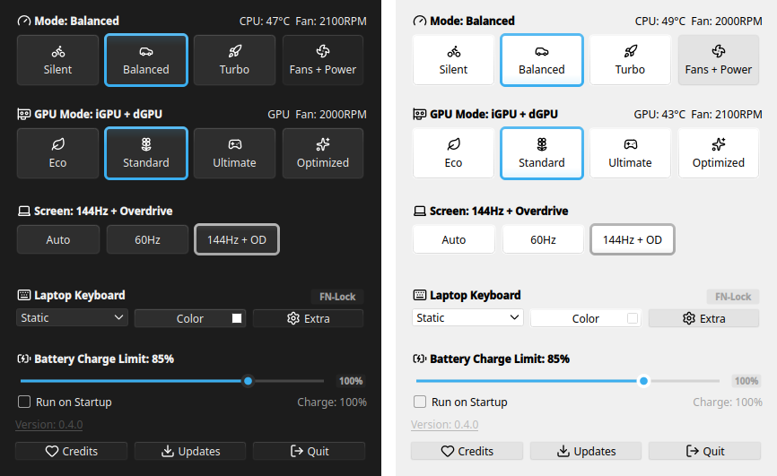
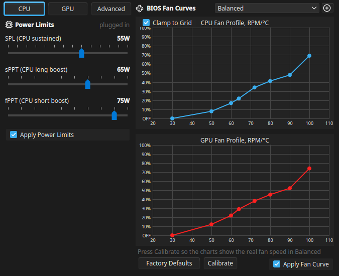

<h1 align="center">
  <br>
  asus-tso-helper
</h1>

<p align="center">
  <b>Inspired by <a href="https://github.com/seerge/g-helper">G-Helper</a>.</b> One small Linux app for ASUS laptops: power modes, fans,<br>
  GPU modes, keyboard lighting, battery and the Fn keys, with G-Helper's windows and behaviour.
</p>

<p align="center">
  <a href="https://github.com/sprinterz5/asus-tso-helper/releases/latest"></a>
  <a href="https://github.com/sprinterz5/asus-tso-helper/releases"></a>
  <a href="https://copr.fedorainfracloud.org/coprs/thesecondone/asus-tso-helper/"></a>
  <a href="LICENSE"></a>
</p>

<p align="center">
  <a href="https://github.com/sprinterz5/asus-tso-helper/releases/latest/download/asus-tso-helper-x86_64.AppImage"><b>⬇ Download the AppImage</b></a>
  &nbsp;·&nbsp; <a href="#install">Fedora and Arch packages</a>
  &nbsp;·&nbsp; <a href="#troubleshooting">Troubleshooting</a>
  &nbsp;·&nbsp; <a href="ROADMAP.md">Roadmap</a>
</p>

<p align="center">
  <br>
  <sub>The same window in a dark and a light desktop theme: the app follows yours.</sub>
</p>

> [!NOTE]
> **Early release.** Built and tested every day on an ASUS TUF Gaming A15 (FA507NV), Fedora 44,
> KDE Plasma 6 on Wayland. Other ASUS laptops supported by asusctl should work, but nobody has
> confirmed them yet. If you try one, a [report](#reporting-a-problem) helps a lot.

## Why

- **Feels like G-Helper.** Same windows, same layout, same colours, same defaults. The
  interface is [seerge's](https://github.com/seerge) work; this project brings it to Linux.
- **Lightweight.** A single 50 MB AppImage, or a 250 KB package on the system's Python and Qt. In
  the tray it starts no background processes, only reads a few system files every 2 seconds.
- **Eco without a logout.** GPU modes go through [Cardwire](https://opengamingcollective.github.io/cardwire/):
  Eco and Standard switch in a moment, and HDMI keeps working.
- **One password, once.** On first start a Setup window installs what the laptop still needs
  (asusd, Cardwire, the key rule) behind a single prompt. No terminal steps.
- **Updates in one click.** A red version label means a new release: one click downloads it,
  checks GitHub's SHA-256 and restarts into it.

## Features



**Performance**
- Silent, Balanced, Turbo and your own custom modes; each power source remembers its mode
- Fan curves for CPU and GPU, calibrated to real RPM, with factory defaults
- CPU power limits (SPL, sPPT, fPPT), NVIDIA Dynamic Boost and temperature target
- CPU Boost and the CPU's power mode (EPP) per mode

**GPU**
- Eco, Standard, Ultimate (MUX) and Optimized (Eco on battery)
- The tray tooltip names the apps keeping the dGPU awake

**Screen, keyboard, battery**
- 60 Hz, max Hz or automatic by power source, panel overdrive
- Aura effects, colour, speed, brightness, backlight timeout, lighting on boot and sleep
- Charge limit, one-time charge to 100%, battery health, time left

**Keys and system**
- Actions for Fn+F4, the Armoury key and other laptop keys, plus any keyboard shortcut
- MangoHud toggle, clamshell mode, run on startup
- BIOS for your model (the ASUS source G-Helper uses), kernel, NVIDIA driver, asusctl,
  Cardwire and firmware updates in one window
- Light and dark theme following the desktop, optionally in the desktop's accent colour
- English and Russian; a translation is one JSON file

<br clear="right">

## Install

### AppImage (any distribution)

Download [`asus-tso-helper-x86_64.AppImage`](https://github.com/sprinterz5/asus-tso-helper/releases/latest/download/asus-tso-helper-x86_64.AppImage),
then run it:

```bash
chmod +x asus-tso-helper-x86_64.AppImage
```

```bash
./asus-tso-helper-x86_64.AppImage
```

It adds itself to the app menu and opens Setup for anything the laptop is missing. Runs on
distributions with glibc 2.34 or newer: Fedora 35+, Ubuntu 22.04+, Debian 12+, Arch.

### Fedora (COPR)

For Fedora 43, 44, 45 and rawhide. asusctl and Cardwire come from the Terra repository, which
the app's Setup adds.

```bash
sudo dnf copr enable thesecondone/asus-tso-helper
```

```bash
sudo dnf install asus-tso-helper
```

### Arch (AUR)

`asus-tso-helper` goes up on the AUR as soon as its registration reopens. Until then, build it
from [`packaging/aur/PKGBUILD`](packaging/aur/PKGBUILD) with `makepkg -si`. Cardwire is in the AUR.

### From source

```bash
git clone https://github.com/sprinterz5/asus-tso-helper
```

```bash
./asus-tso-helper/asus-tso-helper
```

Needs Python 3 with PySide6, python-evdev and dbus-python. Build the AppImage with
`packaging/appimage/build-in-podman.sh`.

## Requirements and support

| Needs | |
|---|---|
| **Laptop** | An ASUS laptop supported by [asusctl](https://asus-linux.org), ROG and TUF first of all |
| **GPU modes** | [Cardwire](https://opengamingcollective.github.io/cardwire/) and a kernel with BPF LSM (Fedora and Arch have it; Ubuntu needs a boot option) |
| **NVIDIA driver** | Optional: for games on the dGPU and its temperature |

| Desktop | Status |
|---|---|
| **KDE Plasma 6** | Main target, everything works: on-screen toasts, the logout prompt, windows opening at the tray icon |
| **GNOME** | Should work; the tray needs the AppIndicator extension. Refresh rate goes through Mutter |
| **Sway, Hyprland, other wlroots** | Should work; refresh rate through `wlr-randr` |
| **X11** | Refresh rate through `xrandr` |

GNOME and wlroots support was tested in containers, not on real desktops yet.

## GPU modes

| Mode | What it does | Switching |
|---|---|---|
| **Eco** | Only the integrated GPU; the NVIDIA GPU powers off | A moment, no logout |
| **Standard** | Both GPUs; the NVIDIA GPU sleeps until a game or app uses it | A moment, no logout |
| **Ultimate** | The NVIDIA GPU drives the screen directly (MUX), for the most FPS | Reboot |
| **Optimized** | Eco on battery, Standard when plugged in | Automatic |

Eco and Standard go through Cardwire, the successor of supergfxd from the asus-linux and Open
Gaming Collective people. It never unloads the NVIDIA driver: it stops new programs from opening
the dGPU, which then powers down by itself. Programs already using the dGPU keep it awake until
they quit; the app names them and offers to close them.

## Troubleshooting

<details>
<summary><b>The Fn keys do nothing</b></summary>

The app needs read access to the "Asus WMI hotkeys" device, and nothing else from the keyboard.
Open **Extra → Setup**; the "Laptop keys" row installs the rule. Some keys (Fn+F2 / F3 keyboard
light, Fn+Esc Fn-Lock) are handled by the firmware and never reach Linux.
</details>

<details>
<summary><b>Eco is on, but the NVIDIA GPU stays awake</b></summary>

A program opened it before the switch and still holds it. Hover the tray icon: the tooltip names
it. Close it, or turn on **Extra → Stop all apps using GPU when switching to Eco**.
</details>

<details>
<summary><b>A red line says asusd or cardwired is not running</b></summary>

Click it to start the service. If that does not help, open **Extra → Setup**. On Ubuntu the
kernel starts without BPF LSM, which Cardwire needs; see
[Cardwire's docs](https://opengamingcollective.github.io/cardwire/).
</details>

<details>
<summary><b>The mode changes by itself when I plug in the charger</b></summary>

That is on purpose: each power source remembers the mode last used on it, as in G-Helper. Pick
the mode you want on battery once, and it comes back every time you unplug.
</details>

<details>
<summary><b>CPU Boost is greyed out</b></summary>

Writing the boost switch needs a one-time permission: open **Extra → Setup**, row "CPU Boost switch".
</details>

### Reporting a problem

**Extra → Diagnostics** saves a text report: laptop model, kernel, package versions, services,
what asusd and Cardwire report, and their recent logs. Your home folder and computer name are
removed. Attach it to an [issue](https://github.com/sprinterz5/asus-tso-helper/issues).

## Contributing

- **Testers with other ASUS laptops** help the most: a Diagnostics report and a few words on what
  works. ASUS mice, keyboards and headsets too; see [ROADMAP.md](ROADMAP.md).
- **Translations**: copy `asus_tso_helper/translations/ru.json`, translate the values, open a pull request.
- **Code**: plain Python and Qt (PySide6). [ROADMAP.md](ROADMAP.md) lists what is done, what is
  next and how each G-Helper feature maps to Linux.

## Credits

- **[G-Helper](https://github.com/seerge/g-helper) by seerge**: the interface, layout, colours,
  behaviour and defaults this app follows. If you like this app, support G-Helper too.
- **[asus-linux](https://asus-linux.org)** and **[Open Gaming Collective](https://github.com/OpenGamingCollective)**:
  asusctl / asusd and Cardwire, which do the actual hardware work.
- **[Lucide](https://lucide.dev)**: icons (ISC licence, `asus_tso_helper/assets/icons/LICENSE`).

## Support

Donations through GitHub Sponsors and Open Collective are being set up. Until then, a ⭐ and a
report from your laptop help the most.

## License

[GPL-3.0](LICENSE), like G-Helper.

An unofficial project, not affiliated with the G-Helper project. Not affiliated with or endorsed by ASUS. ASUS, ROG and TUF are trademarks of ASUSTeK Computer Inc.
